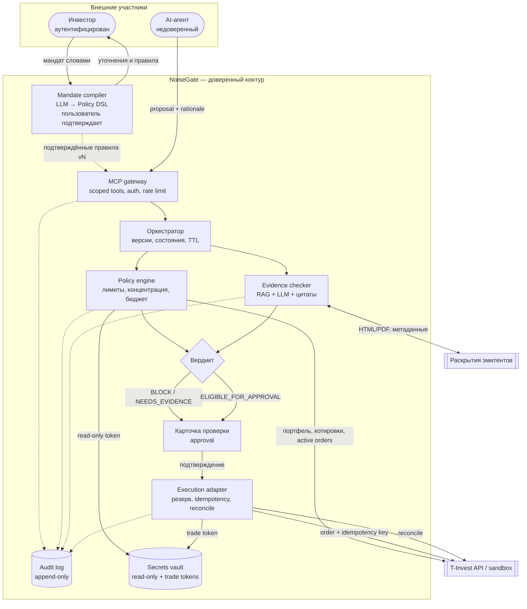
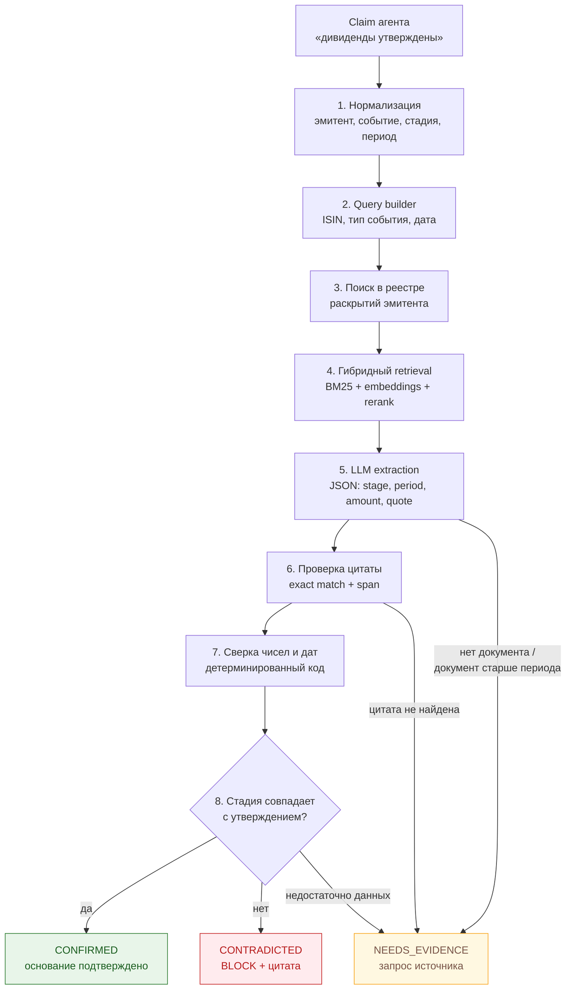
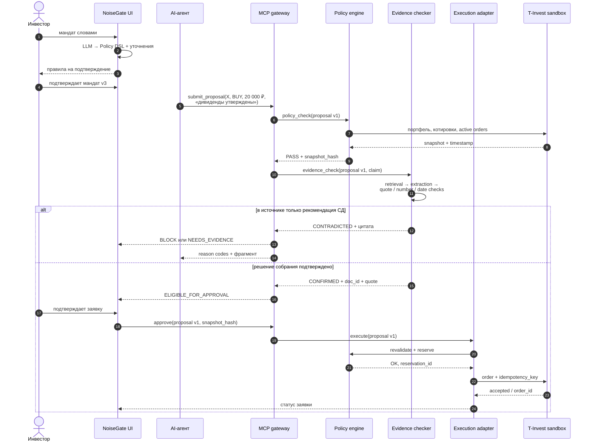
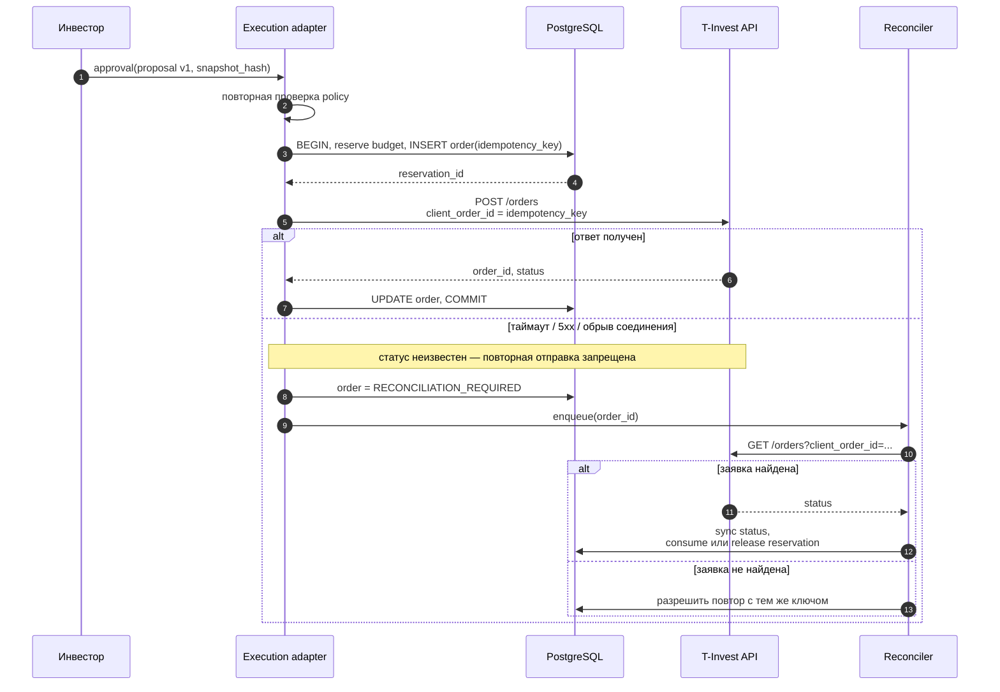
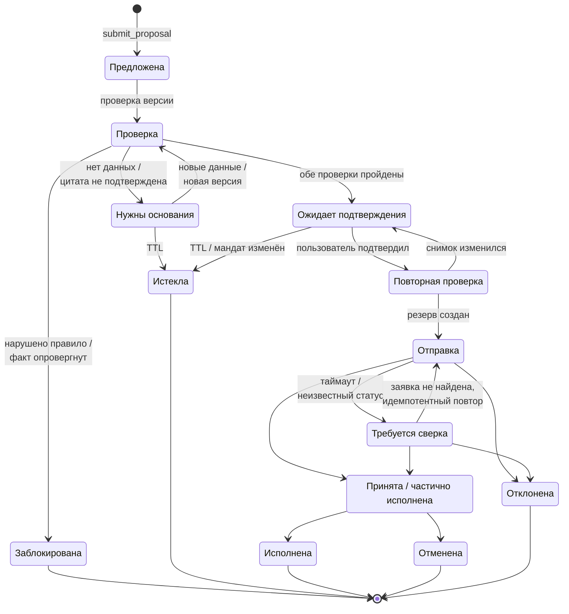
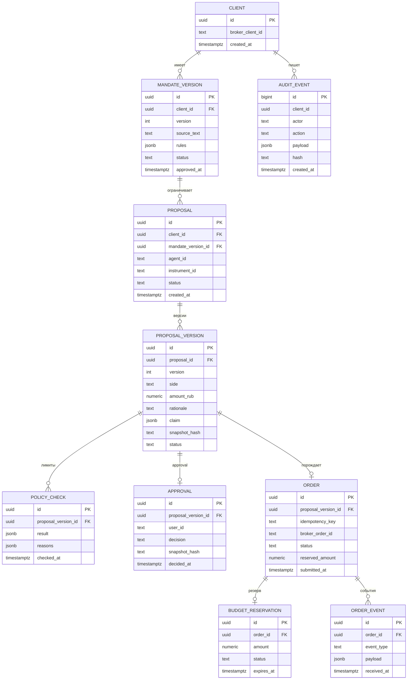
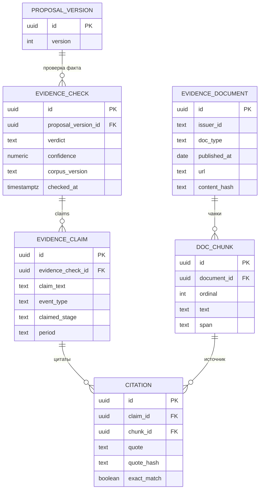

# NoiseGate

**Предторговый контроль заявок AI-агентов, которые торгуют через MCP.**

Инвестор формулирует мандат словами. Агент предлагает сделку и объясняет её. NoiseGate проверяет лимиты и основание сделки по первоисточнику — до того, как заявка уйдёт брокеру.

`Инвест. Премаркет` · `MVP: T-Invest sandbox` · `LLM + RAG` · `human-in-the-loop`

---

## Содержание

- [Заявка](#заявка)
  - [Опишите идею и область её применения](#опишите-идею-и-область-её-применения)
  - [Почему команда выбрала эту идею](#почему-команда-выбрала-эту-идею)
  - [Как будет работать решение](#как-будет-работать-решение)
  - [Что именно будет делать AI](#что-именно-будет-делать-ai)
  - [AI-подходы](#ai-подходы)
  - [Почему выбранные подходы подходят](#почему-выбранные-подходы-подходят)
  - [Технический контур MVP](#технический-контур-mvp)
  - [Какие данные потребуются](#какие-данные-потребуются)
  - [Как вы проверите, что решение работает](#как-вы-проверите-что-решение-работает)
  - [Риски и стоп-факторы](#риски-и-стоп-факторы)
  - [Дополнительный материал](#дополнительный-материал)
- [Архитектура](#архитектура)
  - [Принципы](#принципы)
  - [Контуры доверия](#контуры-доверия)
  - [Компоненты](#компоненты)
  - [Проверка основания](#проверка-основания)
  - [Основной сценарий](#основной-сценарий)
  - [Сбой, повтор и сверка](#сбой-повтор-и-сверка)
  - [Жизненный цикл заявки](#жизненный-цикл-заявки)
  - [Модель данных](#модель-данных)
  - [MCP-интерфейс и вердикты](#mcp-интерфейс-и-вердикты)
  - [Безопасность и надёжность](#безопасность-и-надёжность)
  - [Границы MVP](#границы-mvp)
- [Источники](#источники)

---

## Заявка

### Опишите идею и область её применения

*819 / 900 знаков*

1. Область. Предторговый контроль заявок внешних AI-агентов в Т-Инвестициях.
2. Для кого. Частные инвесторы, которые поручают AI-агенту работу с брокерским счётом.
3. Задача. NoiseGate сверяет заявку с правилами инвестора и проверяет её обоснование по первоисточнику. Агент может говорить об утверждённых дивидендах, хотя документ содержит лишь рекомендацию совета директоров.
4. Как сейчас. Инвестор задаёт права доступа и сам сверяет заявку с лимитами и документами.
5. Формат. Прототип — MCP-шлюз в песочнице с карточкой проверки. Целевой формат — обязательная проверка на стороне брокера, которую агент не может обойти.
6. Результат. Инвестор видит, соблюдены ли лимиты и подтверждены ли факты. Шлюз останавливает заявки, нарушающие обязательные правила. Брокер получает единый контроль заявок подключённых агентов.

### Почему команда выбрала эту идею

*501 / 600 знаков*

- В апреле 2026 года Банк России сообщил о манипуляциях на Мосбирже с использованием трёх Telegram-каналов.
- Агент с доступом к счёту через MCP может принять пост за факт и предложить сделку в пределах лимитов.
- Изучили 22 материала о стартапах YC. В них не нашли описания проверки брокером того, на чём агент основывает заявку.
- Предполагаем, что сверка с первоисточником поможет заметить ошибку до сделки. Проверим точность на раскрытиях эмитентов, а понятность предупреждений — с пользователями.

### Как будет работать решение

*798 / 1000 знаков*

1. Агент предлагает купить акции компании X на 20 000 ₽, потому что «дивиденды уже утвердили». NoiseGate получает заявку, объяснение агента, лимиты инвестора, состав портфеля и активные заявки.
2. Сервис проверяет сумму покупки и долю компании в портфеле после сделки. Затем находит документ эмитента и сверяет его с объяснением агента.
3. В карточке появляется результат. Лимиты соблюдены. В документе есть рекомендация совета директоров, а утверждение выплаты собранием акционеров пока не подтверждено. Рядом показаны цитата и ссылка на документ.
4. Инвестор видит расхождение. Агент получает то же замечание и может исправить своё предложение.
5. Инвестор возвращает заявку на пересмотр. Агент уточняет основание сделки, а NoiseGate заново проверяет обновлённое предложение перед подтверждением.

### Что именно будет делать AI

*690 / 700 знаков*

LLM переводит ограничения клиента в формальные правила и запрашивает уточнения для неоднозначных условий. При проверке заявки модель выделяет утверждение агента и извлекает из раскрытия эмитента стадию решения, период и размер выплаты. Например, фраза «совет директоров рекомендовал утвердить дивиденды» содержит слово «утвердить», хотя решение описано только как рекомендация. Поиск находит документ, а модель сопоставляет его смысл с утверждением. Она приводит цитату, код проверяет её наличие и совпадение извлечённых чисел и дат. При недостатке данных или расхождении повторных ответов модели вывод откладывается. Лимиты, расчёт долей и разрешение отправки обрабатываются обычным кодом.

### AI-подходы

- [x] **LLM**
- [x] **RAG**
- [ ] TF-IDF — используется как базовый метод в эксперименте

### Почему выбранные подходы подходят

*367 / 400 знаков*

LLM переводит ограничения клиента в формальные правила и извлекает из раскрытий стадию, период и размер выплаты. RAG подбирает первоисточник для конкретного инструмента и события. Модель сопоставляет утверждение агента с документом и приводит цитату. Проверка лимитов и решение об отправке выполняются обычным кодом. Вклад LLM сравниваем с ключевыми словами и TF-IDF.

### Технический контур MVP

*1118 / 1200 знаков*

1. Компоненты. MCP-шлюз проверяет ограничения и ведёт заявки. Сервис проверки источников разбирает раскрытия. В веб-интерфейсе инвестор задаёт правила, видит результаты и подтверждает заявку.
2. Модели. Основной кандидат — T-Pro 2.0. Модель переводит ограничения в формальные правила и извлекает из документов стадию решения, период и цитату. Лимиты проверяет код.
3. Хранилища. PostgreSQL хранит версии правил, заявки, подтверждения, резервы и журнал. Документы храним в файловом хранилище.
4. Интеграции. Через T-Invest API в песочнице получаем портфель, котировки и активные заявки, отправляем поручения и проверяем статус. Факты берём из раскрытий эмитентов.
5. Взаимодействие. Агент передаёт предложение через MCP. Шлюз проверяет лимиты и через брокер сообщений запускает проверку источника. Результат привязан к версии предложения. После подтверждения шлюз повторно проверяет лимиты, резервирует бюджет и отправляет заявку. При сбое сверяет её статус перед повторной отправкой.
6. Результат. Инвестор видит соблюдение лимитов, вывод по источнику и статус заявки. Агент получает причину предупреждения или отказа.

### Какие данные потребуются

*692 / 700 знаков*

Правила клиента и заявки агента поступают как текст и структурированные поля при каждом изменении или новом предложении. Портфель, активные заявки, котировки и справочник получаем из T-Invest MCP/API в виде ответов и потоков обновлений. Состояние счёта сверяем при проверке и перед отправкой. Раскрытия получаем по запросу в HTML/PDF. Для демо берём 5–10 эмитентов, для оценки — 150–300 документов из более широкого круга эмитентов. Сохраняем дату, версию, ссылку и цитату. Для оценки размечаем стадию решения в публичных документах и ожидаемый результат сквозных сценариев. Ограничения: разные форматы и недоступность отдельных раскрытий, задержки данных, отличия песочницы от боевых торгов.

### Как вы проверите, что решение работает

*648 / 700 знаков*

Проверим, лучше ли LLM со сверкой по цитате выявляет расхождения в стадии события. Разметим 150–300 раскрытий о дивидендах и 100 сценариев «мандат, заявка, документ». Из 100 сценариев 70 оставим для теста. Документы одного события держим в одной части выборки. Сравним с ключевыми словами и TF-IDF на одинаковых данных. Цель — найти не менее 90% существенных расхождений при доле ложных предупреждений не выше 2% на корректных заявках и определять стадию минимум на 10 п. п. точнее лучшего базового метода. Для обязательных условий цель — ноль ложных подтверждений на тесте. Два человека размечают данные независимо. Укажем доверительные интервалы.

### Риски и стоп-факторы

*763 / 800 знаков*

1. Клиентам хватает текущего контроля, брокеру не нужен новый слой. Проверим спрос в 5–8 интервью и разговоре с ментором Т.
2. Раскрытия недоступны или относятся к другому периоду. Без них нельзя подтвердить факт. Соберём пробный корпус и измерим долю проверяемых случаев.
3. Модель ошибается в правилах или стадии выплаты. Это ведёт к пропуску нарушения и ложным предупреждениям. Проверим по 20 мандатам и 20 документам и сравним с простым методом.
4. Агент может отправить заявку в обход шлюза. Проверим интеграцию в песочнице, изолируем токен и обсудим с Т размещение проверки на стороне брокера.
5. Повторы и параллельные заявки могут создать дубль или превысить бюджет. Проверим резервирование и сверку статуса тестами сетевых сбоев и одновременных запросов.

### Дополнительный материал

Репозиторий проекта с архитектурой и Mermaid-диаграммами: [github.com/zetnilabs/NoiseGate](https://github.com/zetnilabs/NoiseGate).

---

## Архитектура

### Принципы

1. **Агент предлагает — шлюз решает.** Внешний агент не получает права отправлять заявку в обход NoiseGate. В MVP это обеспечивается изоляцией токена и MCP-шлюзом; целевой формат — обязательная проверка на стороне брокера.
2. **Жёсткие правила проверяет код.** Лимиты, концентрация, бюджет, резервы и разрешение отправки считаются детерминированно. LLM не принимает решение «можно ли торговать».
3. **Ни одного факта без цитаты.** Вывод по основанию сделки действителен только вместе с документом, датой публикации, точной цитатой и проверенными числами/датами.
4. **Fail closed.** Нет источника, источник устарел, цитата не найдена или модель дала противоречивые ответы — это `NEEDS_EVIDENCE`, а не разрешение.
5. **Человек подтверждает.** Проверенная заявка не уходит автоматически: инвестор видит карточку и подтверждает её.
6. **Версия и снимок важнее момента.** Решение привязано к версии заявки, версии мандата, снимку портфеля и набору доказательств. Изменение любого из них требует повторной проверки.
7. **Доставка at-least-once, исполнение at-most-once.** Идемпотентность, резерв бюджета и сверка статуса защищают от дублей при сбоях и параллельных запросах.

### Контуры доверия



**Что важно в схеме:**

- у агента нет брокерского токена и нет tool «отправить заявку»;
- брокерские токены хранятся в secrets vault: read-only доступен `Policy engine`, trade — только `Execution adapter`; агенту и LLM токены недоступны;
- агент видит причину отказа и может выпустить новую версию предложения, но не может отредактировать уже подтверждённую;
- все проверки и действия пишутся в audit log.

### Компоненты

| Компонент | Ответственность | Что не делает |
|---|---|---|
| **Web UI / BFF** | Ввод мандата, уточнения, карточка проверки, подтверждение, журнал | Не хранит брокерский токен |
| **Mandate compiler** | Переводит текст мандата в Policy DSL, задаёт уточняющие вопросы, валидирует схему | Не проверяет заявки и не торгует |
| **MCP gateway** | Аутентификация агента, узкий набор tools, идемпотентность запросов, rate limit, canonicalization | Не отправляет ордера |
| **Оркестратор** | Состояния заявки, очереди, таймауты, повторы, outbox, TTL | Не принимает инвестиционных решений |
| **Policy engine** | Детерминированная проверка лимитов, концентрации, бюджета и активных заявок; read-only доступ к счёту | Не интерпретирует документы |
| **Evidence checker** | Поиск первоисточника, извлечение факта, проверка цитаты, чисел и дат | Не разрешает отправку |
| **Execution adapter** | Повторная проверка, резерв бюджета, отправка с idempotency key, reconciliation; trade-токен | Не принимает заявки от агента напрямую |
| **Secrets vault** | Хранит read-only и trade токены, выдаёт их по роли | Не отдаёт токены агенту или LLM |
| **Audit log** | Неизменяемый журнал версий, проверок, подтверждений и событий ордера | Не участвует в принятии решения |

**Предлагаемый стек MVP:**

| Слой | Выбор | Зачем |
|---|---|---|
| API и MCP | Python, FastAPI, официальный MCP SDK | Быстрый прототип, строгие схемы запросов и ответов |
| Асинхронность | RabbitMQ + transactional outbox | Проверка источника не блокирует агента, события не теряются |
| Хранилища | PostgreSQL, S3-совместимое файловое хранилище | Версии, резервы, журнал; документы и цитаты |
| LLM | T-Pro 2.0 через provider adapter, версия закреплена | Перевод мандата и извлечение фактов; возможность замены модели |
| Retrieval | BM25 + multilingual embeddings + rerank | Найти первоисточник, а не просто похожий текст |
| Разбор документов | HTML/PDF parser, OCR-fallback | Раскрытия в разных форматах |
| Наблюдаемость | OpenTelemetry, метрики, structured logs | Разбор инцидентов и контроль качества |

### Проверка основания

Ключевой сценарий — дивиденды. Агент говорит «дивиденды утверждены», а первоисточник может содержать только рекомендацию совета директоров. Задача контура — не спорить с агентом словами, а извлечь стадию события и подтвердить её цитатой.



**Стадии события дивидендов:**

| Стадия | Что подтверждает документ | Можно ли считать «утверждено» |
|---|---|---|
| `RECOMMENDED_BY_BOARD` | Совет директоров рекомендовал выплату | Нет |
| `AGM_SCHEDULED` | Собрание акционеров назначено | Нет |
| `APPROVED_BY_AGM` | Общее собрание утвердило выплату | Да |
| `PAID` | Выплата фактически произведена | Да, для факта выплаты |

**Схема ответа модели** — не свободный текст, а структура, которую можно проверить кодом:

```json
{
  "claim": {
    "issuer": "X",
    "event": "dividends",
    "claimed_stage": "APPROVED",
    "period": "2026"
  },
  "evidence": {
    "doc_id": "disclosure-2026-04-001",
    "published_at": "2026-04-10",
    "stage": "RECOMMENDED_BY_BOARD",
    "amount_per_share": 12.5,
    "quote": "Совет директоров рекомендовал…",
    "quote_span": [1820, 1914]
  },
  "confidence": 0.91
}
```

Код проверяет, что `quote` действительно входит в указанный фрагмент, что числа и даты совпадают с документом, а `stage` входит в контролируемый словарь. Если проверка не проходит — `NEEDS_EVIDENCE`.

### Основной сценарий



### Сбой, повтор и сверка

Отдельный критичный сценарий — таймаут при отправке. В этот момент неизвестно, принял ли брокер заявку. Повторная отправка без сверки может создать дубль, поэтому статус сначала выясняется по `client_order_id`.



### Жизненный цикл заявки



### Модель данных



Вторая проекция — доказательства. Связь с заявкой идёт через `proposal_version_id`:



### MCP-интерфейс и вердикты

Агенту доступен только узкий контракт. Он не может подтвердить заявку, отправить ордер или получить брокерский токен.

| MCP tool | Назначение | Ограничения |
|---|---|---|
| `submit_proposal` | Создать предложение: инструмент, сторона, сумма, обоснование | Только для своего клиента; лимит размера и частоты |
| `revise_proposal` | Выпустить новую версию с уточнённым основанием | Не меняет подтверждённую версию |
| `get_proposal` | Получить статус, reason codes, цитату и ссылку | Только свои предложения |
| `cancel_proposal` | Отозвать ожидающее предложение | Только до подтверждения |
| `get_mandate_summary` | Прочитать действующие ограничения | Только read-only, без персональных данных |

**Вердикты:**

| Вердикт | Когда | Что видит агент | Что делает инвестор |
|---|---|---|---|
| `ELIGIBLE_FOR_APPROVAL` | Лимиты соблюдены, факт подтверждён цитатой | `PENDING_HUMAN_APPROVAL` | Подтверждает или отклоняет |
| `BLOCK` | Нарушено обязательное правило или факт противоречит источнику | Причина, цитата, ссылка | Видит нарушение; может вернуть на пересмотр |
| `NEEDS_EVIDENCE` | Нет источника, он устарел, цитата не найдена или ответы модели расходятся | Чего не хватает | Видит, что факт не подтверждён |
| `EXPIRED` | Истёк TTL или изменился мандат | Нужно новое предложение | Видит причину |
| `RECONCILIATION_REQUIRED` | Отправка прошла, но статус неизвестен | Статус неопределён, повтор запрещён | Видит, что идёт сверка |

**Пример Policy DSL:**

```yaml
mandate_id: mnd_01
version: 3
universe: [MOEX_EQ]
max_order_amount_rub: 20000
max_position_share: 0.10
monthly_budget_rub: 50000
conditions:
  - id: dividends_must_be_approved
    when:
      action: BUY
      instrument:
        issuer: "X"
    require:
      fact: dividend_stage
      equals: APPROVED_BY_AGM
      source: issuer_disclosure
approval:
  mode: always
```

### Безопасность и надёжность

**Границы доверия и защита:**

- агент аутентифицируется в MCP gateway собственным scoped-токеном; брокерские токены хранятся в secrets vault: read-only — для policy engine, trade — только для execution adapter;
- MCP gateway ограничивает размер и схему входящих данных, инструменты, частоту запросов и TTL предложения;
- документы раскрытий считаются недоверенным содержимым: LLM не получает tools, работает по схеме, а цитата и числа проверяются кодом;
- при расхождении двух прогонов извлечения вывод откладывается (`NEEDS_EVIDENCE`), а не усредняется;
- audit log хранит версию мандата, версию заявки, `snapshot_hash`, `doc_id`, цитату, версию модели и все переходы состояния;
- в целевой архитектуре проверка переносится на сторону брокера, чтобы агент не мог обойти шлюз прямым вызовом API.

**Надёжность исполнения:**

- бюджет резервируется в транзакции вместе с созданием записи ордера;
- `idempotency_key` генерируется до отправки и сохраняется вместе с заявкой;
- outbox-паттерн гарантирует, что событие не потеряется между БД и очередью;
- reconciler разбирает неизвестные статусы и не отправляет повтор, пока не увидит результат первой попытки;
- у предложения и резерва есть TTL; просроченные записи не блокируют бюджет.

**Метрики качества:**

- доля заявок, по которым основание подтверждено или опровергнуто, а не отложено;
- точность определения стадии и число ложных подтверждений на обязательных условиях;
- p95 задержки policy check и evidence check (с кэшем и без);
- число `RECONCILIATION_REQUIRED`, дублей и расхождений с брокером;
- доля предупреждений, которые инвестор понял без пояснений (проверяется на пользователях).

### Границы MVP

**Входит в прототип:**

- 5–10 эмитентов, дивиденды как основной тип события;
- T-Invest sandbox: портфель, котировки, активные заявки, отправка и статус;
- один внешний агент, один клиент, обязательное подтверждение человеком;
- policy engine, evidence checker, карточка проверки, audit log;
- тесты на сбой отправки, повтор и параллельные заявки.

**Не входит в MVP:**

- боевые торги и реальные деньги;
- маржинальные и короткие сделки;
- автономное подтверждение без человека;
- мультиброкерность и несколько юрисдикций;
- налоговый и регуляторный расчёт;
- полноценная промышленная HA-инфраструктура.

---

## Источники

Дата обращения: **16.11.2026**.

### Внешние источники

1. **Банк России, 13.04.2026.** «Установлены факты манипулирования рынком с использованием информации, распространяемой через телеграм-каналы». [Пресс-релиз](https://www.cbr.ru/press/pr/?file=639116712917163472PNP.htm) — контекст: манипуляции через Telegram-каналы и необходимость проверки основания сделки.
2. **Банк России, 28.07.2026.** Интервью «Мы не устраиваем охоту на ведьм». [Материал](https://www.cbr.ru/press/event/?id=32730) — почти три года проверок до передачи материалов в Следственный комитет; показывает, насколько серьёзен контур разбора манипуляций.
3. **T-Bank Dev Portal.** «T-Invest MCP». [Документация](https://developer.tbank.ru/invest/mcp) — MCP-интерфейс, песочница и брокерские данные для MVP.
4. **T-Tech, Hugging Face.** Коллекция T-Pro 2.0. [Модели](https://huggingface.co/collections/t-tech/t-pro-20) — кандидат для перевода мандата в правила и извлечения фактов из раскрытий.

### Материалы команды и референсы

5. **zetnilabs/NoiseGate.** [Репозиторий проекта](https://github.com/zetnilabs/NoiseGate) — README, архитектура и диаграммы.
6. **Рабочий документ заявки.** [Черновик ответов](https://docs.google.com/document/d/1hZmFeE2-wsjLkZWB37vgdRd-416D2Bpo2iaQoWAncts/edit?usp=sharing) — исходные формулировки, из которых собраны ответы для «Инвест. Премаркета».
7. **Яндекс Доски.** [Рабочая доска команды](https://boards.yandex.ru/whiteboard/?hash=b92fb23c20c1df447b9ff19bab40496a) — наброски архитектуры и сценариев.
8. **T-Bank Dev Portal.** [T-Invest MCP: n8n](https://developer.tbank.ru/invest/mcp/platforms-connect/n8n-platform) — пример подключения T-Invest MCP к платформе оркестрации; ориентир для интеграции.
9. **Composer.** [composer.trade](https://www.composer.trade/) — референс интерфейса и агентного трейдинга.
10. **Y Combinator.** [AnyAlpha](https://www.ycombinator.com/companies/anyalpha) — агентная торговая платформа; один из первых референсов команды.

### YC-лендскейп: 22 материала

Список соответствует 22 материалам, указанным в заявке: 18 компаний и 4 запуска.

<details>
<summary>Показать список</summary>

**Компании (18):**

1. [Spectre Intelligence](https://www.ycombinator.com/companies/spectre-intelligence)
2. [Prodigy Research](https://www.ycombinator.com/companies/prodigy-research)
3. [Fire Wallet](https://www.ycombinator.com/companies/fire-wallet)
4. [Gravy](https://www.ycombinator.com/companies/gravy)
5. [River Markets](https://www.ycombinator.com/companies/river-markets)
6. [Standard Signal](https://www.ycombinator.com/companies/standard-signal)
7. [Sequence Markets](https://www.ycombinator.com/companies/sequence-markets)
8. [Instinct](https://www.ycombinator.com/companies/instinct-xyz)
9. [Freeport Markets](https://www.ycombinator.com/companies/freeport-markets)
10. [Casey](https://www.ycombinator.com/companies/casey)
11. [Fernstone](https://www.ycombinator.com/companies/fernstone)
12. [Autonomous Technologies Group](https://www.ycombinator.com/companies/autonomous-technologies-group)
13. [QFEX](https://www.ycombinator.com/companies/qfex)
14. [Arbital](https://www.ycombinator.com/companies/arbital)
15. [DataNode](https://www.ycombinator.com/companies/datanode)
16. [Volaren](https://www.ycombinator.com/companies/volaren)
17. [Versine](https://www.ycombinator.com/companies/versine)
18. [Covera](https://www.ycombinator.com/companies/covera)

**Запуски (4):**

1. [Scalar Field — agentic trading desk](https://www.ycombinator.com/launches/RZm-scalar-field-the-agentic-trading-desk)
2. [Conviction — trading desk in your pocket](https://www.ycombinator.com/launches/U6n-conviction-trading-desk-in-your-pocket)
3. [Scalar Field — trading terminal with an intelligent agent](https://www.ycombinator.com/launches/NSw-scalar-field-reinventing-the-trading-terminal-one-intelligent-agent-at-a-time)
4. [Lofty — the Nasdaq for real estate](https://www.ycombinator.com/launches/LGz-lofty-the-nasdaq-for-real-estate)

</details>

---

<p align="center"><sub>NoiseGate · агент предлагает, шлюз проверяет, инвестор подтверждает</sub></p>
